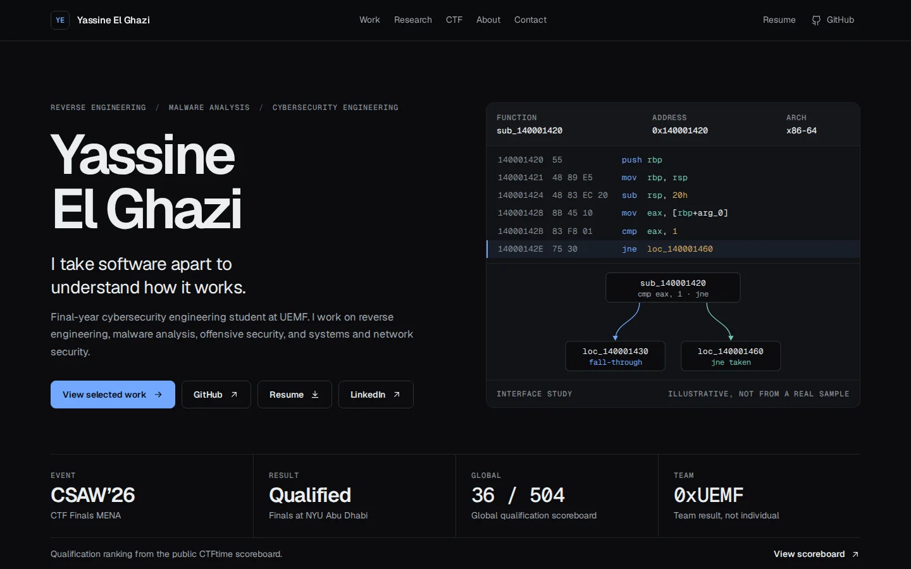

# Yassine El Ghazi — Cybersecurity portfolio

A fast, static portfolio for a cybersecurity engineering student at UEMF interested in reverse engineering and malware analysis: selected projects, CTF team achievements, technical skills, education, and public contact details.

**Live site:** https://yassine-el-ghazi.github.io/



## Stack
Astro 7, strict TypeScript, semantic HTML, custom responsive CSS, and GitHub Pages. A locally hosted Space Grotesk variable font provides the heading typography; the body uses system fonts. No client JavaScript, analytics, backend, runtime API calls, or third-party embeds.

## Local development
Requires Node.js 22.12+; CI uses Node.js 24.

```sh
npm ci
npm run dev
```

## Production checks
```sh
npm run check
npm run build
npm run audit:site
npm run preview
```

`check` validates Astro and TypeScript. `audit:site` checks generated internal links and fragment targets, duplicate IDs, required metadata/assets, unexpected client scripts, and common private-data patterns in source. These checks complement manual privacy review; they do not prove that all possible secrets are absent.

## Content structure
```text
src/
  components/       # Header, hero, projects, about, competitions, contact
  data/             # Profile, skills, projects, competition highlights
  layouts/          # Shared document, SEO and social metadata
  pages/            # Homepage and custom 404
  styles/           # Responsive design and reduced-motion support
scripts/            # Build audit
.github/workflows/  # Checks and Pages deployment
```


## Deployment
The repository name matches the GitHub account: `Yassine-El-Ghazi.github.io`. Astro's `site` is the root URL with no project `base` path. In **Settings → Pages**, select **GitHub Actions** as the source.

Every push to `main` installs locked dependencies, checks types, builds, audits the site, uploads only `dist/`, and deploys to GitHub Pages. Pull requests run checks without deployment. Actions are pinned to immutable commit SHAs; deployment has scoped Pages and OIDC permissions. No private token is embedded in the site or workflow.

## Design and accessibility
- Dark neutral palette with a restrained amber accent, annotated x86-64 assembly, and an APK static-analysis workflow.
- Semantic headings and landmarks, skip link, visible keyboard focus, descriptive links.
- Mobile layouts, fluid type, reduced-motion support, and no runtime dependencies.
- Canonical URL, Open Graph and Twitter text metadata, favicon, sitemap, robots.txt, and custom 404.

## License
